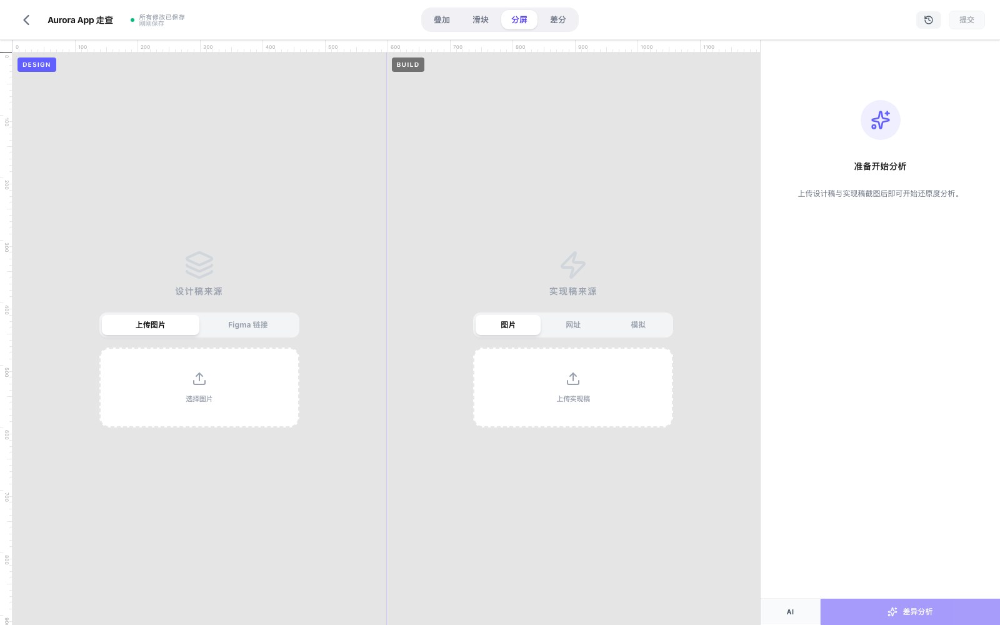
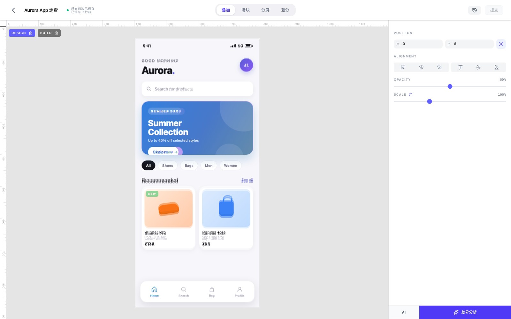
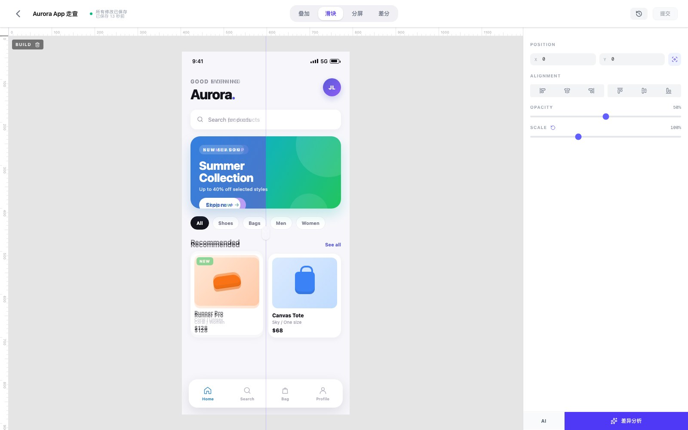
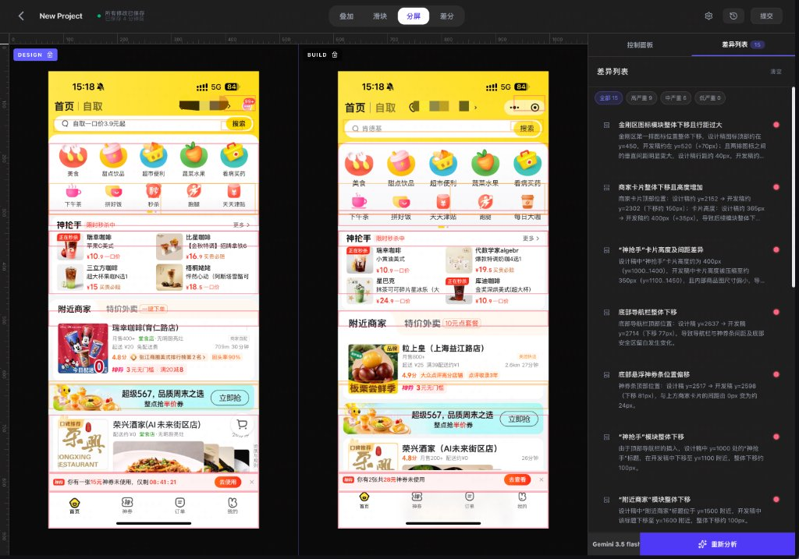
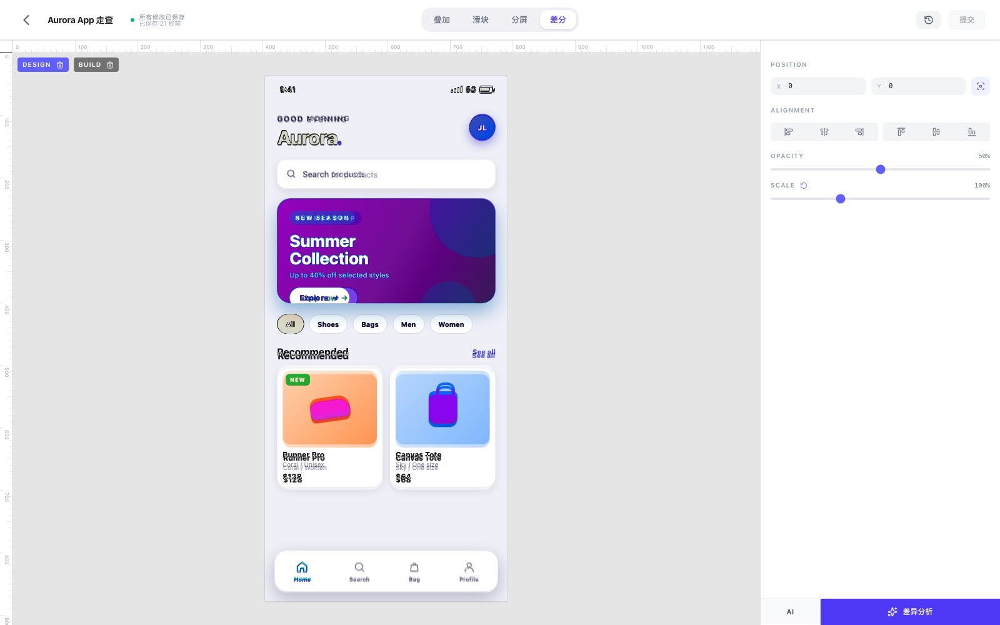
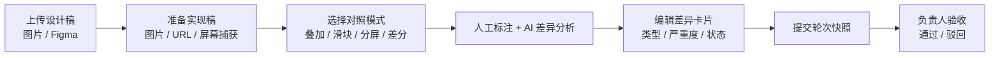
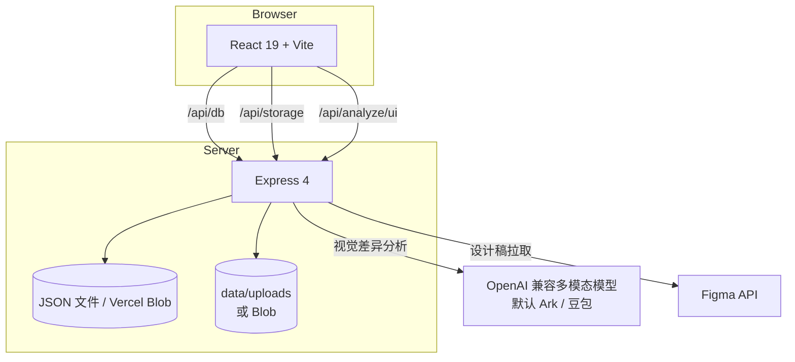

# AIDA

> AI 辅助设计走查工作台：把设计稿与实现稿放在一起对照，用 AI 生成可追踪的差异卡片，并按轮次完成验收。


AIDA（AI Design Assistant）面向设计师与前端团队：上传设计稿和实现稿，在四种对照模式下检查还原度，让 AI 给出结构化的差异建议，再通过「轮次验收」把走查结论沉淀下来。

它不替代 CI 里的像素回归测试，而是补齐「人如何评审一次 UI 还原」这段流程。

## 为什么是 AIDA

纯像素对比能告诉你「哪里变了」，但不能告诉你「哪里不对、该不该修、修完谁来确认」。AIDA 把三件事放进同一个工作台：

- **看得见**：设计稿与实现稿叠加、滑动、分屏或差分对照。
- **说得清**：AI 按内容 / 布局 / 样式分类输出差异，并附严重度与坐标。
- **收得住**：差异可标记修复，按轮次提交验收，历史分析可回看。

## 核心能力

- **多种输入来源**：设计稿支持本地图片 / Figma 链接；实现稿支持本地图片 / 在线 URL / 屏幕捕获（模拟）。不用先跑构建流水线，也能开始一次走查。
- **四种对比模式**：叠加（Overlay）、滑块（Slider）、分屏（Split）、差分（Diff），支持缩放、平移与快捷对齐，覆盖位置、间距、颜色和像素变化。
- **AI 差异分析**：调用任意 OpenAI 兼容的多模态视觉模型（默认接入火山引擎 Ark / 豆包），内置长图重叠切片、左右并排像素标尺对照与模块分隔带像素预检，输出 `内容 / 布局 / 样式` 三类差异、严重度与设计稿 / 实现稿双坐标。
- **多模型切换**：可配置多个模型（支持跨供应商独立 base URL 与 Key），在分析栏下拉选择，按次生效并记住选择。
- **可视化模型设置**：在设置页添加 / 编辑 / 删除模型、拉取供应商模型列表、测试连接、设置默认模型；环境变量模型只读展示，密钥仅保存在服务端。
- **人工标注**：在画布上框选差异，编辑类型与严重度，标记已修复或忽略。
- **轮次验收**：把当前设计稿、实现稿与差异集固化为一个轮次快照，状态支持待验收 / 已通过 / 已驳回。
- **项目管理**：项目、分类、搜索、星标、回收站（软删除），支持拖拽归类。
- **偏好设置**：左侧栏底部（移动端在项目列表头部菜单）切换外观（跟随系统 / 浅色 / 深色）与界面语言（简体中文 / English），偏好保存在浏览器本地。
- **可靠保存**：输入停顿后自动保存（指纹去重）、分析结果可命名归档、保存失败有错误提示。
- **私有化部署**：本地 JSON + 文件存储，或 Vercel Blob；内置访问口令与 SSRF 防护。

## 界面与模式

设计稿可从本地图片或 Figma 链接导入，实现稿支持本地图片、在线 URL 与屏幕捕获：



同一组设计稿 / 实现稿可以在四种模式下切换：

| 叠加 Overlay | 滑块 Slider |
| --- | --- |
| **检查位置与尺寸偏差**<br/> | **逐区域对比细节**<br/> |

| 分屏 Split | 差分 Diff |
| --- | --- |
| **左右并排查看整体还原度与 AI 差异定位**<br/> | **快速定位像素变化区域**<br/> |

## 工作流



## 快速开始

### 环境要求

- Node.js 20+（开发机验证于 Node 24）
- npm 10+
- AI 分析需要一组 OpenAI 兼容的多模态模型配置：`AI_API_BASE_URL`、`AI_API_KEY`、`AI_MODEL`（旧的 `ARK_API_KEY` / `DOUBAO_MODEL_ID` 仍可作为回退）；需要多模型切换时改用 `AI_MODELS`，也可以启动后在「设置 · 模型」页面可视化添加
- 从 Figma 拉取设计稿需要 `FIGMA_ACCESS_TOKEN`

### 启动

```bash
npm install
cp .env.example .env.local   # 按需填写
npm run dev                  # http://localhost:3000
```

开发服务器同时提供 Vite 前端与 `/api/*` 接口。

> 未设置 `ACCESS_PASSWORD` 时，服务只接受本机回环地址访问，远程请求会返回 403。部署到公网前请务必设置访问口令。

### 第一次走查

1. 打开 `http://localhost:3000`，点击「新建项目」。
2. 在「设计稿来源」上传图片，或粘贴 Figma 链接后点击「获取」。
3. 在「实现稿来源」上传截图、填写页面 URL，或使用屏幕捕获。
4. 切换叠加 / 滑块 / 分屏 / 差分模式检查还原度。
5. 点击「差异分析」让 AI 生成差异卡片（需配置多模态模型）。
6. 审阅并调整卡片后，点击「提交」创建轮次，交由负责人验收。

## 使用说明

### 对照模式

| 模式 | 用途 | 操作 |
| --- | --- | --- |
| 叠加 Overlay | 检查位置与尺寸偏差 | 拖动设计稿图层，调节透明度 |
| 滑块 Slider | 逐区域对比细节 | 拖动分割线 |
| 分屏 Split | 左右并排查看 | 缩放 / 平移两侧画布 |
| 差分 Diff | 快速定位变化区域 | 查看像素差分结果 |

### 差异卡片

- **类型**：内容（CONTENT）、布局（LAYOUT）、样式（STYLE）。
- **严重度**：高 / 中 / 低，可点击循环切换。
- **状态**：待处理 / 已修复 / 已忽略；已处理项折叠在「已解决」分组。
- **定位**：点击卡片可在设计稿与实现稿上同时高亮对应区域。

### 轮次验收

提交轮次时，系统会保存当轮的设计稿、实现稿与差异快照。负责人可将轮次状态设为「已通过」或「已驳回」，后续每轮都可与历史轮次对照。

### 分析历史

完成一次 AI 分析后可命名保存，在分析历史中回看当时的差异集与截图；历史分析支持恢复与删除。

### 偏好设置（外观与语言）

- **外观**：跟随系统 / 浅色 / 深色三态。桌面端在左侧栏底部切换，移动端在项目列表头部右上角的偏好菜单里切换；「跟随系统」会实时跟随操作系统的深浅色设置。
- **语言**：简体中文 / English，覆盖项目列表、Checker、模型设置页及全部按钮、占位符、提示与页面标题。
- 偏好保存在浏览器 `localStorage`（`theme` 与 `aida:language`），切换即时生效，刷新后保留；不会同步到服务端，也不影响其他浏览器。
- 项目名、分类名、成员名等用户数据与 AI 产出的差异描述始终保持原文，不随界面语言翻译。

## 配置

### 环境变量

| 变量 | 必填 | 说明 |
| --- | --- | --- |
| `PORT` | 否 | 本地端口，默认 `3000` |
| `DATA_DIR_NAME` | 否 | 数据目录，默认 `data`；支持绝对路径 |
| `ACCESS_PASSWORD` | 公网必填 | 访问口令；设置后需登录，未设置时仅本机回环地址可访问 |
| `AI_API_BASE_URL` | AI 分析 | OpenAI 兼容端点，默认 `https://ark.cn-beijing.volces.com/api/v3` |
| `AI_API_KEY` | AI 分析 | 模型服务 API Key；未设置时回退 `ARK_API_KEY` |
| `AI_MODEL` | AI 分析 | 多模态模型 ID；未设置时回退 `DOUBAO_MODEL_ID` |
| `AI_MODELS` | 多模型 | JSON 数组，每项 `{ id, label, baseUrl, apiKey, model }`；可跨供应商，缺省字段继承 `AI_API_*`。设置后优先于单模型配置，但低于设置页添加的自定义模型 |
| `ARK_API_KEY` | 兼容 | 旧变量，等价于 `AI_API_KEY` |
| `DOUBAO_MODEL_ID` | 兼容 | 旧变量，等价于 `AI_MODEL` |
| `FIGMA_ACCESS_TOKEN` | 按需 | 从 Figma 链接拉取设计稿 |
| `BLOB_READ_WRITE_TOKEN` | Vercel 必填 | Vercel Blob 读写令牌；缺失时启动即失败 |
| `NODE_ENV` | 否 | `development` / `production` |
| `DISABLE_HMR` | 否 | 设为 `true` 时关闭 Vite HMR |

### 模型配置示例

只要服务实现 OpenAI Chat Completions 协议并支持图片输入，就可以直接接入；换成其他供应商通常只需改 base URL 和模型 ID。

| 服务 | `AI_API_BASE_URL` | `AI_MODEL` |
| --- | --- | --- |
| 火山引擎 Ark | `https://ark.cn-beijing.volces.com/api/v3` | 豆包视觉模型 Endpoint ID |
| Google Gemini（OpenAI 兼容） | `https://generativelanguage.googleapis.com/v1beta/openai` | `gemini-2.5-flash` 等 |
| OpenAI | `https://api.openai.com/v1` | `gpt-4o` 等支持视觉的模型 |
| 通义千问（DashScope 兼容模式） | `https://dashscope.aliyuncs.com/compatible-mode/v1` | `qwen-vl-max` 等 |
| OpenRouter | `https://openrouter.ai/api/v1` | 任一支持视觉的模型 ID |

需要同时接入多个供应商时，用 `AI_MODELS` 配置模型列表，每个模型可独立指定 `baseUrl` / `apiKey`：

```bash
AI_MODELS='[
  {"id":"doubao","label":"豆包 Vision","baseUrl":"https://ark.cn-beijing.volces.com/api/v3","apiKey":"your-ark-key","model":"doubao-vision"},
  {"id":"gpt-4o","label":"GPT-4o","baseUrl":"https://api.openai.com/v1","apiKey":"sk-xxx","model":"gpt-4o"}
]'
```

未填写的 `baseUrl` / `apiKey` 继承 `AI_API_BASE_URL` / `AI_API_KEY`。可用模型通过 `/api/config` 下发（不含密钥），分析栏可随时切换，选择会保存在浏览器本地。

### 在界面中配置模型

点击项目列表侧栏底部的「设置」（移动端在头部偏好菜单里），或 Checker 顶部的齿轮，进入「设置 · 模型」，可直接管理模型，无需改环境变量：

- 添加 / 编辑 / 删除自定义模型：填写名称、Base URL、API Key 与模型 ID；支持从服务商拉取模型列表（失败仍可手填）和测试连接。
- 设置默认模型；删除默认模型后，列表会自动回退到下一个可用模型。
- 自定义模型与环境变量模型合并展示，自定义在前；环境变量模型只读，请修改服务端配置。
- API Key 只保存在服务端，接口仅返回 `••••` 掩码；分析请求按所选模型路由到对应的 base URL 与 Key。

优先级：设置页自定义模型 > `AI_MODELS` > `AI_API_*` > `ARK_*` / `DOUBAO_MODEL_ID` 旧变量。

自定义模型与密钥存放在独立安全存储中：本地为 `data/ai-models.json`（权限 `0600`），Vercel 为私有 Blob `secure/ai-models.json`，不会写入公开可读的集合文件。

### 常用脚本

| 命令 | 说明 |
| --- | --- |
| `npm run dev` | 启动开发服务器（API + Vite） |
| `npm run build` | 构建前端到 `dist/` |
| `npm run build:server` | 编译后端到 `dist-server/` |
| `npm run build:all` | 依次构建前端与后端 |
| `npm start` | 生产模式启动（`prestart` 自动重新构建） |
| `npm run typecheck` | 前端 strict + 后端类型检查 |
| `npm run lint` | typecheck + ESLint（`src api tests`） |
| `npm test` | 运行 Vitest 测试 |

## 架构



### 数据模型

数据按集合存放，默认位于 `data/*.json`：

| 集合 | 内容 |
| --- | --- |
| `projects` | 项目元信息、封面、分类、软删除标记 |
| `categories` | 项目分类与排序 |
| `analysisResults` | 命名保存的分析结果 |
| `projects_<projectId>_rounds` | 每个项目的验收轮次快照 |

上传图片存放在 `data/uploads/`，JSON 中仅保存相对 URL。

设置页添加的模型与密钥使用独立安全存储：本地 `data/ai-models.json`（`0600`），Vercel 私有 Blob `secure/ai-models.json`；不进入上述公开集合。

### API 概览

| 方法 | 路径 | 说明 |
| --- | --- | --- |
| `GET` | `/api/health` | 健康检查（运行环境、存储与鉴权配置） |
| `GET` | `/api/config` | 可用 AI 模型列表与配置状态（需鉴权，不含密钥） |
| `GET/POST/PUT/DELETE` | `/api/ai-models[/:id]` | 自定义模型增删改查（需鉴权，密钥脱敏） |
| `PUT` | `/api/ai-models/default` | 设置默认模型 |
| `POST` | `/api/ai-models/test` | 测试模型连接（15 秒超时，20 次/分钟） |
| `POST` | `/api/ai-models/fetch-models` | 拉取供应商模型列表（20 次/分钟） |
| `POST` | `/api/auth/login` | 口令登录，签发 HttpOnly Cookie |
| `GET/POST/PUT/DELETE` | `/api/db/:collection[/:id]` | 集合读写删（集合白名单） |
| `POST` | `/api/analyze/ui` | 设计稿 / 实现稿 AI 差异分析 |
| `POST` | `/api/storage/upload` | 上传 base64 图片 |
| `GET/DELETE` | `/api/storage/file/:filename` | 读取 / 删除上传文件 |
| `POST` | `/api/figma/fetch` | 解析 Figma 链接并拉取设计稿 |
| `GET` | `/api/proxy-image` | 受控图片代理（域名白名单） |

## 安全设计

- **访问控制**：`ACCESS_PASSWORD` 登录后签发 HttpOnly Cookie；未配置口令时仅允许本机回环访问，远程默认拒绝。
- **限流**：登录 10 次/分钟，AI 分析 20 次/分钟。
- **SSRF 防护**：图片代理仅允许 https 与精确域名白名单，DNS 解析结果命中私网 / 云元数据地址即拒绝，重定向逐跳复验。
- **上传约束**：仅接受 jpg / jpeg / png / webp / gif，单文件上限 15MB，服务端按真实 MIME 归一化扩展名。
- **模型密钥**：设置页保存的 API Key 仅存在于服务端安全存储（本地 `0600` 文件 / Vercel 私有 Blob），任何接口、日志与错误信息都不返回明文。
- **文件名校验**：读取、写入、删除共用同一个文件名白名单正则，阻断路径穿越。
- **数据写保护**：同一集合的读改写串行执行，本地写入使用临时文件 + rename 原子替换。

AIDA 使用单一共享口令，不是多租户账号体系；请把它部署在内网或受信网络中。

## 部署

### Vercel

1. 导入仓库，构建命令 `npm run build`，输出目录 `dist`。
2. 配置环境变量：`BLOB_READ_WRITE_TOKEN`（必须）、`AI_API_BASE_URL`、`AI_API_KEY`、`AI_MODEL`、`FIGMA_ACCESS_TOKEN`、`ACCESS_PASSWORD`（公网强烈建议）。
3. 部署后访问 `/api/health`，确认 `status` 为 `ok`、`blobConfigured` 为 `true`。

Vercel 上数据与文件都存放在 Blob；未配置 `BLOB_READ_WRITE_TOKEN` 会直接启动失败，避免静默写到只读文件系统。

### 自托管

```bash
npm ci
npm run build:all
ACCESS_PASSWORD='your-password' npm start
```

生产模式由 Express 直接托管 `dist/` 与 API。请定期备份 `data/`；删除项目为软删除，不会立即清除上传文件。

## 测试与质量

```bash
npm test          # 单元 / 集成测试（临时数据目录，不触碰 data/）
npm run lint      # 严格类型检查 + ESLint
npm run build     # 前端生产构建
```

测试覆盖鉴权决策、数据读写、上传协议、AI 请求契约与 JSON 解析。后端使用 Vitest + Supertest 直接挂载 Express app，不依赖真实网络。

## 已知限制

- AI 分析仅支持 OpenAI 兼容的 Chat Completions 多模态接口；不支持 Anthropic Messages、Gemini 原生协议等私有格式。
- Checker 为桌面优先工具，建议宽度 ≥1024px；项目列表已适配移动端。
- 回收站只有软删除与恢复，暂未提供永久删除 / 清空入口。
- Blob 模式下的跨实例并发写没有 ETag / 事务保护，多实例高并发写同一集合需额外串行化。
- 前端尚无端到端自动化测试，核心链路目前依赖集成测试与人工走查。

## 许可

本项目采用 [MIT License](LICENSE) 开源。
